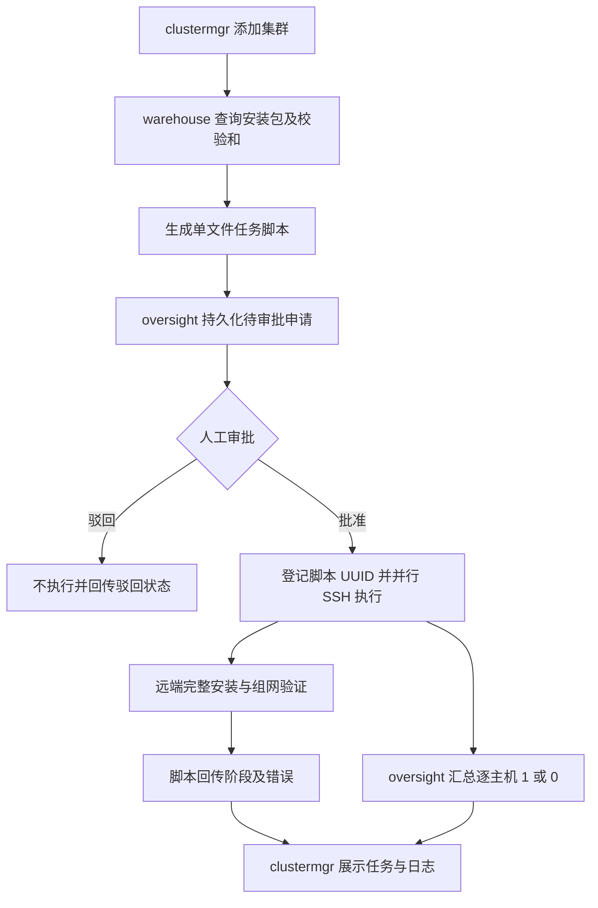

# ycyh-all

YCYH 项目集群部署验证工程，版本 **0.1.0**。三个子工程独立运行；顶层 Maven 只聚合 Java 子工程，未来 Python、Go 等子工程可放在同一仓库并使用各自构建工具。

| 子工程 | 技术 | 默认端口 | 功能 |
|---|---|---:|---|
| oversight | JDK 11 / Maven / Spring Boot / JDBC / MySQL 或 PostgreSQL | 8081 | 脚本登记、调用申请、人工审批、通过 SSH 执行、审批与执行记录 |
| warehouse | JDK 11 标准库 HttpServer，无第三方运行时依赖 | 8082 | 目录清单、文件下载、带 SHA-256 的组件目录 |
| clustermgr | JDK 11 / Maven / Spring Boot / Thymeleaf / JDBC | 8080 | 登录、Banner 与用户信息、ES 管理菜单、部署申请、主机进度、安装与错误回传 |

**本版本的审批流程：添加一个集群，只提交一份 DEPLOYMENT 申请。** 该申请包括一份不可修改的组合脚本和全部目标主机，审批一次后由 oversight 并行 SSH 到各主机执行。clustermgr 不连接目标主机。



## 1. 下载包与源码构建

发布包中的 `dist/` 含三个可运行 JAR；`docs/` 含接口、设计、脚本架构规范和验证说明。

源码构建需要 JDK 11、Maven 3.8+、Python 3（组装和检查脚本）；服务运行只需 JRE/JDK 11，oversight 所在机器另需 OpenSSH 客户端。前端无需 Node.js、npm 或公网 CDN。

```bash
java -version
mvn -version
python3 scripts/assemble.py --check
mvn -B -ntp clean verify
bash bin/package.sh
```

单独构建：`mvn -pl oversight -am package`，其他子工程同理。未来非 Java 项目不加入 Maven `<modules>`，在自己的目录保存依赖锁文件、构建入口和 README。

本版本因 JDK 11 约束采用 Spring Boot 2.7.18；它已结束社区开源支持，适合作为本模拟系统基线。面向正式环境需确认受维护发行版或规划 JDK 升级，不把这个原型视为生产加固版。出处见 `docs/ARCHITECTURE.md`。

## 2. 数据库准备（二选一）

为 oversight 和 clustermgr 分别建立数据库。应用启动时读取各自 `src/main/resources/schema.sql` 执行 `CREATE TABLE IF NOT EXISTS`，不会清空已有表。后续正式迭代应引入版本迁移工具。

### PostgreSQL

已有数据库可由 DBA 执行：

```sql
CREATE USER ycyh WITH PASSWORD '替换为实际密码';
CREATE DATABASE oversight OWNER ycyh;
CREATE DATABASE clustermgr OWNER ycyh;
```

连接地址分别为：

```text
jdbc:postgresql://数据库IP:5432/oversight
jdbc:postgresql://数据库IP:5432/clustermgr
```

也可启动测试数据库：

```bash
export DB_PASSWORD='替换为实际密码'
docker compose -f deploy/compose-db.yml --profile postgres up -d
```

### MySQL

```sql
CREATE DATABASE oversight CHARACTER SET utf8mb4 COLLATE utf8mb4_unicode_ci;
CREATE DATABASE clustermgr CHARACTER SET utf8mb4 COLLATE utf8mb4_unicode_ci;
CREATE USER 'ycyh'@'%' IDENTIFIED BY '替换为实际密码';
GRANT ALL PRIVILEGES ON oversight.* TO 'ycyh'@'%';
GRANT ALL PRIVILEGES ON clustermgr.* TO 'ycyh'@'%';
```

```text
jdbc:mysql://数据库IP:3306/oversight?useUnicode=true&characterEncoding=UTF-8&serverTimezone=Asia/Shanghai
jdbc:mysql://数据库IP:3306/clustermgr?useUnicode=true&characterEncoding=UTF-8&serverTimezone=Asia/Shanghai
```

TLS、服务证书与数据库认证参数按客户环境增加。测试数据库容器启动：

```bash
export DB_PASSWORD='替换为实际密码'
export MYSQL_ROOT_PASSWORD='替换为独立的root密码'
docker compose -f deploy/compose-db.yml --profile mysql up -d
```

测试容器只绑定本机回环地址；远程部署数据库须按网络规划调整。选择一个 profile 即可。内网提前导入所选数据库镜像，Maven 首次构建需可用的内部依赖镜像或完整本地缓存。

## 3. 主机与网络准备

每个目标主机需要：

- Linux；与 ES 安装包匹配的 CPU 架构、glibc 与操作系统。模板识别 ES 7.17.x / 8.x 正式版 Linux tar.gz；未宣称覆盖所有补丁版与 OS 组合。
- Bash、Python 3、curl、sha256sum、sed、nohup、seq、gzip/tar 支持；安装包中应有 `bin/elasticsearch` 与可执行的捆绑 `jdk/bin/java`。
- 独立的非 root 用户，例如 `es`；可写 home、至少数 GB 空间；当前登录会话 `nofile >= 65535`，主机 `vm.max_map_count >= 262144`。由管理员预先设置，脚本不提权。
- 一主机一 ES 实例，9200/9300 未被占用；9200/9300 必须允许所有集群节点互通。

网络：oversight → 目标主机 SSH（默认22）；目标主机 → warehouse HTTP（8082）；目标主机 → clustermgr 回传 HTTP（8080）；clustermgr → oversight HTTP（8081）；浏览器 → 两个 Web 服务。clustermgr 无需访问目标主机。

在 oversight 的运行用户下预先配置私钥和 `known_hosts`。将公钥放到每个 `es` 用户的 `~/.ssh/authorized_keys`，权限按 OpenSSH 要求设置。主机指纹需通过可信渠道核验后加入 `known_hosts`；本工程强制 `StrictHostKeyChecking=yes`，不自动接受未知指纹。

```bash
ssh -T -i /home/oversight/.ssh/id_ed25519 \
  -o BatchMode=yes -o IdentitiesOnly=yes \
  -o StrictHostKeyChecking=yes \
  -o UserKnownHostsFile=/home/oversight/.ssh/known_hosts \
  es@192.168.10.11 'id; ulimit -n; cat /proc/sys/vm/max_map_count'
```

SSH 用户名和 IP 同时受 oversight 白名单约束；clustermgr 还维护允许选择的主机清单。两个配置必须一致。当前页面仅支持 IPv4，SSH 统一使用配置的端口和私钥，暂不实现密码或每主机独立凭据管理。

## 4. 配置三个服务

复制示例并填写环境变量文件，文件内容为 Shell `KEY=value` 语法。密码或 URL 含特殊字符时使用单引号。

```bash
cp config/oversight.env.example config/oversight.env
cp config/clustermgr.env.example config/clustermgr.env
chmod 600 config/oversight.env config/clustermgr.env
```

关键配置：

| 变量 | 服务 | 含义 |
|---|---|---|
| DB_URL / DB_USER / DB_PASSWORD | 两个后端 | 各自的数据库地址和凭据 |
| OVERSIGHT_API_KEY | 两个后端 | 相同的服务间密钥，至少24字符 |
| OVERSIGHT_ADMIN_USER / OVERSIGHT_ADMIN_PASSWORD | oversight | 审批页面账户；密码至少12字符 |
| ADMIN_USER / ADMIN_PASSWORD | clustermgr | 集群管理账户；密码至少12字符 |
| SSH_ALLOWED_HOSTS | oversight | 允许的主机 IP，英文逗号分隔，无空格 |
| SSH_ALLOWED_USERS | oversight | 允许的 SSH 用户，英文逗号分隔 |
| SSH_PRIVATE_KEY / SSH_KNOWN_HOSTS | oversight | 服务进程可读的密钥与可信主机文件 |
| SSH_TIMEOUT_SECONDS | oversight | 每次主机脚本执行超时，默认1200秒，不含审批等待 |
| CLUSTER_HOSTS | clustermgr | `192.168.10.11@es,192.168.10.12@es` |
| WAREHOUSE_URL | clustermgr | **目标主机也能访问**的仓库地址 |
| CALLBACK_BASE_URL | clustermgr | **目标主机也能访问**的回传地址，不能误填本机 localhost |
| OVERSIGHT_URL | clustermgr | clustermgr 与浏览器均可访问的管控服务地址 |
| ALLOW_INSECURE_ES | clustermgr | 默认 false；本隔离验证模板须显式设为 true |

本模板明确关闭 ES 安全认证，以聚焦审批和安装闭环；只在隔离测试网使用。正式模板需另行完成 TLS、账户、证书分发、资源与运维策略；不会因当前安装成功就具备这些能力。两套页面各有独立登录会话，不共享管理员身份。

## 5. 启动

先将官方、架构和版本匹配的 ES 压缩包放入 `repository/`（可用子目录），不要放凭据或其他私密文件。目录中的所有普通文件都可下载；仓库目录应由可信的制品维护人员管理。

```bash
mkdir -p repository logs
java -jar dist/warehouse-0.1.0.jar ./repository 8082
```

另开终端启动 oversight：

```bash
set -a
source config/oversight.env
set +a
java -jar dist/oversight-0.1.0.jar
```

另开终端启动 clustermgr：

```bash
set -a
source config/clustermgr.env
set +a
java -jar dist/clustermgr-0.1.0.jar
```

生产式后台托管可交给 systemd，示例见 `deploy/ycyh-service.example.service`。此原型三个服务只配置 HTTP；实际内网如需 HTTPS，可在经授权的网关终止 TLS，并正确配置回传地址和浏览器地址。

## 6. 页面操作

1. 打开 `http://管理服务IP:8080`，使用配置的管理员账户登录。
2. 左侧 **ES 管理 → ES 集群部署**，右上角 **添加集群**。
3. 填写以小写字母开头的集群名，选择仓库 tar.gz，选择1—8台主机，提交一次部署申请。
4. 集群列表进入“等待审批”。点击“打开审批”，在 oversight 用审批人账户登录，核对脚本、SHA-256、IP、用户，填写审批意见后批准或驳回。
5. 批准后 oversight 先登记本次脚本，再并行执行全部目标主机；不再为每台主机、每个安装阶段申请审批。
6. clustermgr 的详情页面显示逐主机阶段与错误。最终成功需要该主机退出码为0，且回传最终 `SUCCEEDED`（该回传在 ES 节点数、集群名与健康状态验证通过后发出）。

新建集群的首次引导配置在验证成功后从每台机器的 `elasticsearch.yml` 删除。安装默认目录 `$HOME/ycyh-es/集群名/es-N`，堆内存512 MiB，仅供验证；详细日志位于 `$HOME/ycyh-es/集群名/任务ID.log` 及 ES 自身 logs。

失败不会自动删除安装目录或停止可能已经启动的节点，也不自动重试。主机安装互斥，已存在目标目录时拒绝覆盖。查看远端真实状态后由维护人员制定修复动作，再提交新的审批申请。

## 7. 结果语义与边界

审批新增了等待环节，因此原来的“执行请求立即返回1/0”调整为：提交返回 HTTP202 与申请ID；通过查询申请获取状态；完成后结果接口返回纯文本 `1` 或 `0`。待审批与执行中返回 HTTP202 `PENDING`。未知状态也返回202 PENDING（须人工核查）。

所有**脚本登记与执行调用**都要审批；登录、审批动作和只读状态查询属于该流程的控制/查询操作，不会触发脚本，也不递归创建审批申请。一次 DEPLOYMENT 的审批同时覆盖登记及整批执行。

管控结果 `1` 代表退出码0；`0` 包括非零退出、超时、SSH失败、队列满或驳回，不代表没有副作用、也不代表已回滚。调用或服务中断记为 UNKNOWN，不自动重复执行。现阶段仅支持新建部署，不提供扩缩容、ES 索引管理、集群删除、生产 TLS 配置、HA、多副本调度或真实业务负载验证。

## 8. 文档与测试

- [总体设计](docs/ARCHITECTURE.md)
- [接口与审批协议](docs/API.md)
- [脚本编写架构与规范](docs/SCRIPT_STANDARD.md)
- [验证说明与结果](docs/VERIFICATION.md)
- 自动化：`mvn verify`；真实 SSH：`bash tests/ssh-integration.sh`；受限容器备用：`python3 tests/ssh-userland.py`（额外需要测试依赖 paramiko）。
- 数据库与真实 HTTP 冒烟：服务启动后 `python3 tests/http-smoke.py`；该测试批准脚本上传、驳回部署申请，不在目标主机安装 ES。
- `.github/workflows/ci.yml` 在 main 推送时执行 JDK11 构建、SSH测试和 PostgreSQL/MySQL 冒烟；全部成功后创建不可移动的 `0.1` 标签，不创建 Release。
- Git仓库仅提交源码、配置和文档，不提交 `dist/` 或 `target/` 中的二进制；克隆后运行 `bash bin/package.sh` 生成JAR，也可在 Actions 下载 `java11-jars` 构建产物。
- 远端CI执行结果见仓库 Actions 记录；`docs/VERIFICATION.md` 记录本地初始验证范围。
