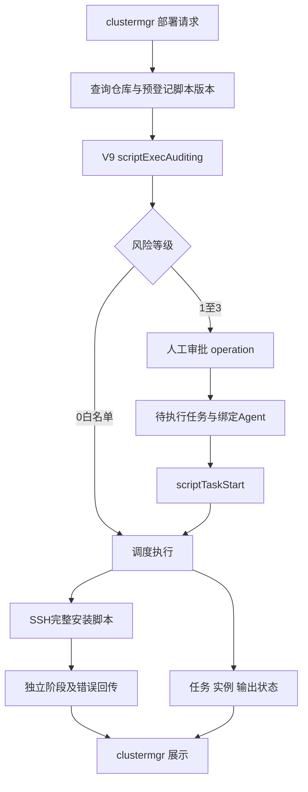

# YCYH V9管控架构

工程仍由oversight、warehouse、clustermgr组成，Java使用JDK11。模块通过HTTP契约集成，未来其他语言模块无需加入Maven继承关系。

## 实现分层

| 类/模块 | 职责 |
|---|---|
| V9Controller / V9AuthorityController | 原文URL、字段和响应封装 |
| V9Identity / V9TokenFilter | username换token、secretToken校验和到期 |
| V9Catalog | Agent/分类/资源组、脚本版本/参数/附件、常用任务 |
| V9Tasks | 风险申请、独立审批/启动、实例、批次、调度、日志与终止 |
| V9SshExecutor | 实际SSH、字面参数传递、私有附件目录、stdout/stderr、进程组取消 |
| V9Store | Long编号、可事务修改的JSON分块存储 |
| clustermgr RemoteSystems | 只调用原文V9接口的客户端适配 |
| 公共Shell框架/ES适配器 | 单脚本完成检查、校验、安装、启动、组网验证、回传 |

## 数据与恢复

新增v9_objects/v9_chunks存储资源、任务、各次实例及Agent运行数据；v9_counter生成Long ID，v9_tokens存储token哈希和到期。审批快照含脚本内容、参数、附件和主机：登记目录的后续变化不修改既有申请。

同一审批只能决策一次；风险任务批准后等待启动，firstBatch/绑定ID控制同一实例不重复执行同一绑定。周期任务产生独立实例，并保留已完成实例历史。SSH执行记录与输出有界，单stdout/stderr各最多1Mi字符，保留尾行用于expectType判定；完整组件日志仍在目标主机。

执行中重启时标记异常/待核查，不把不确定结果自动重新执行。该模拟器是单实例应用，不具备分布式任务抢占或HA协议。实时输出来源于活动SSH流，结束时写库；进程崩溃可能丢失尚未落库的实时输出片段，应结合目标主机日志核查。

SSH严格校验known_hosts并限制IP/用户名。每个运行实例在用户home下的`.ycyh-oversight/实例ID`保存临时脚本、附件和PID；独立进程组使停止操作只针对该实例。取消标记覆盖“刚发起但尚未写PID”的竞态；不能确认停止时返回业务失败，提示核查真实进程。

## 原文边界

平台是V9协议模拟器，不复制客户平台的真实Agent、SSO、ITSM、短信或多人多节点审批基础设施。source/userId/loginName等字段按文档接收并校验当前模拟身份，审批来源留存；未提供外部服务协议的能力不伪造网络调用。

所有已明确字段和路径均由源文档约束，未定义或互相冲突的部分集中见 [V9_PROTOCOL.md](V9_PROTOCOL.md)。Linux SSH是当前执行后端；sh用bash、py用python3，ps1/bat只会调用对应解释器，未安装解释器或不兼容主机会如实异常，不伪装成成功。真实Windows Agent兼容性不在本模拟器已验证范围。

## 版本基础

管理进程保留Spring Boot2.7.18以满足JDK11，发行版维护策略仍需按正式环境确认。ES按自己的捆绑JDK运行。ES PoC模板安全认证关闭、每主机一个9200/9300实例、512MiB堆，正式上线的TLS、容量和角色规划仍需另行实现。

官方参考：[Spring Boot2.7要求](https://docs.spring.io/spring-boot/docs/2.7.18/reference/html/getting-started.html#getting-started.system-requirements)、[2.x支持说明](https://spring.io/blog/2023/11/23/spring-boot-2-7-18-available-now/)、[ES归档安装](https://www.elastic.co/docs/deploy-manage/deploy/self-managed/install-elasticsearch-from-archive-on-linux-macos)、[ES首次组网](https://www.elastic.co/docs/deploy-manage/distributed-architecture/discovery-cluster-formation/modules-discovery-bootstrap-cluster)。
