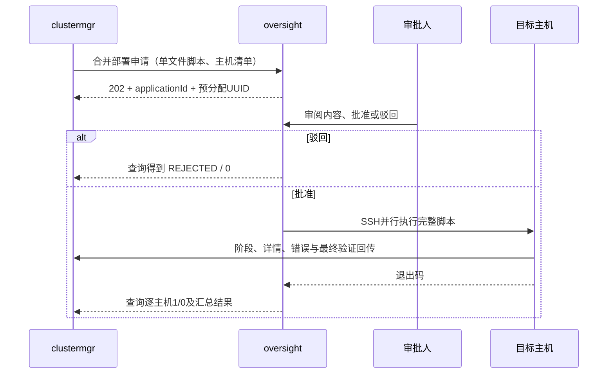

# 总体工程与审批部署架构

## 一、职责划分

`ycyh-all` 是单仓库、多子项目工程。顶层 POM 为 packaging=pom，统一 Java 版本和依赖；每个 Java 服务独立打包、运行、配置、持久化。HTTP/JSON 是子项目间协议，不通过代码继承、同库查询或共享内存耦合业务，便于将后续子项目实现为其他语言。

| 层次 | 当前实现 | 可扩展位置 |
|---|---|---|
| 管理界面 | clustermgr Thymeleaf + 原生 JS/CSS | 保留 REST API，可替换为独立前端 |
| 管控审批界面 | oversight 登录、申请清单、详情、批准/驳回 | 审批角色、审批链、统一身份 |
| 申请协议 | UPLOAD / EXECUTE / DEPLOYMENT | 增加组件操作类型，不绕过审批 |
| 执行器 | oversight SshRunner / OpenSSH | 可替换为客户管控 API 适配器 |
| 组件制品 | warehouse 只读 HTTP 与 SHA-256 | 可替换为客户仓库协议 |
| 脚本框架 | 公共框架 + ES 适配器 → 单文件脚本 | 新组件实现相同阶段钩子 |
| 状态与日志 | JDBC 业务表 + 脚本单向 HTTP 回传 | 对接统一日志、事件与监控平台 |

## 二、审批减少策略

严格按原始两个接口实现时，一次上传审批加 N 次单主机执行审批，总数为 N+1。新增 `POST /api/v1/deployments` 将**登记一份脚本 + 执行多个明确目标**合并为同一申请，审批次数变为1。原有两个接口仍保留，并且也必须审批。

本版本不通过跳板节点二次 SSH，也不要求目标主机之间互配私钥。oversight 对清单中的每台主机直接 SSH，各主机执行同一脚本，其中各自的安装配置按受控环境变量 `YCYH_TARGET_IP` 选出。单次审批覆盖完整脚本、目标清单与用户；审批后不能修改。

上传申请先分配 UUID，批准前脚本尚未进入可执行脚本表；驳回不会登记。DEPLOYMENT 批准时先原子登记脚本并更新审批状态，然后入执行队列。执行申请只能使用已经批准登记的脚本 UUID。申请清单可核对原文与 SHA-256；SHA用于固定内容和辅助审查，不等同于已完成安全审计或电子签名。

## 三、时序与结果判定

管理系统每5秒查询一次已知申请的状态，查询操作不执行脚本。回传与退出结果分别保留：单机只有 `exit=0` 且最终阶段为 SUCCEEDED 才显示部署成功；批量中任意失败都会使集群非成功。

脚本会下载归档、核验 SHA-256、检查归档路径与链接、写入 ES 配置、启动、检查集群名/节点数/健康状态；只有完成验证才回传 SUCCEEDED。所有节点都为默认 master/data 等角色，不是生产角色规划方案。

## 四、数据库与安全边界

| 服务 | 表 | 关键内容 |
|---|---|---|
| oversight | applications | 申请类型、不可变脚本快照、SHA、目标、审批人/意见、状态、结果 |
| oversight | scripts | 已批准的 UUID、名称、SHELL类型、内容、创建时间 |
| oversight | executions | 每台主机执行记录、UUID、用户、状态、结束时间、内部原因码 |
| clustermgr | clusters | 集群、包路径/哈希、管控申请ID、创建时间 |
| clustermgr | deploy_tasks | 主机、用户、脚本UUID、状态/阶段、回传序号、token哈希 |
| clustermgr | deploy_events | 逐任务有序回传消息与阶段 |

数据库中的申请原文和已批准脚本会包含任务回传凭据，属于受限运维数据，备份、查询和保留策略应受管理。管理页面与列表 API 不输出原始回传 token；只有审批详情能查看完整脚本。原型使用单个配置账户分别登录两个系统；服务间 API key 与回传任务 token 分离。密码启动时进行 BCrypt 编码。页面写操作有 CSRF 校验；回传用任务 token 校验，不使用浏览器会话。

API key 只允许申请登记/状态查询，不能通过 API 直接批准申请；批准/驳回必须使用审批页面已登录会话。目标IP、用户名白名单在申请时及执行时校验。SSH 必须预配密钥和可信 known_hosts。数据库采用参数化 SQL，仓库输出转义 HTML，路径必须在仓库 realpath 范围内。

## 五、异常与恢复

| 场景 | 行为 |
|---|---|
| 待审批 | 持久化保存，不执行，也没有审批等待超时计时 |
| 审批驳回 | 结果0，未登记本次脚本/未触发执行 |
| 重复点击审批 | 行锁检查 PENDING，仅第一次决策有效，其后409 |
| 单主机脚本失败或执行超时 | 管控结果0，保留已产生的远端状态 |
| clustermgr 查询中断 | 保持任务状态，下次继续查询同一个申请，绝不重新提交 |
| clustermgr 在申请ID落库前重启 | QUEUED 标记UNKNOWN，人工按文件名中的集群ID核查 |
| clustermgr 已保存申请ID后重启 | 继续查询 WAITING_APPROVAL / RUNNING 任务 |
| oversight 在已批准/执行中重启 | 标记UNKNOWN；不重放执行，需核查远端 |
| 回传重复 | 相同或较旧seq确认接收，不重复写事件，不覆盖状态 |
| 最终回传后出现更高seq | 拒绝409，防止终态降级 |
| 退出0但缺少最终成功回传 | 管理系统记UNKNOWN，不能认定安装成功 |
| SSH断连 | 远端进程不一定终止，不能将0解释为无副作用 |

本版本无自动回滚、自动重新执行或强制关闭进程动作。脚本有主机级目录锁；崩溃导致残留锁时，维护人员先确认无任务执行，再处理残留锁。每主机最多一实例，跨集群端口复用不在本版本范围。

进程限制：最多8台主机/申请，oversight 2个批次执行线程、8个主机线程，批次队列16；clustermgr 2个申请提交线程、队列16。此版本只支持各服务单实例，数据库恢复逻辑并非分布式任务抢占协议，不可直接多副本部署。查询清单当前最多显示oversight最近200条；仓库catalog最多200个包、深度6，且读取时计算SHA，大制品量需增加缓存或独立元数据服务。

## 六、官方依据与版本说明

以下文档用于约束实现，不表示本原型已完成所有平台组合的实测：

- Spring Boot 2.7 系统要求：[官方参考文档](https://docs.spring.io/spring-boot/docs/2.7.18/reference/html/getting-started.html#getting-started.system-requirements)。
- 2.7.18 为2.x最终社区开源版本：[官方发布说明](https://spring.io/blog/2023/11/23/spring-boot-2-7-18-available-now/)。
- ES tar包安装与普通用户运行：[官方安装文档](https://www.elastic.co/docs/deploy-manage/deploy/self-managed/install-elasticsearch-from-archive-on-linux-macos)。
- 首次组网与bootstrap配置：[官方组网文档](https://www.elastic.co/docs/deploy-manage/distributed-architecture/discovery-cluster-formation/modules-discovery-bootstrap-cluster)。
- 组网后删除 cluster.initial_master_nodes：[官方检查说明](https://www.elastic.co/docs/deploy-manage/deploy/self-managed/bootstrap-checks)。
