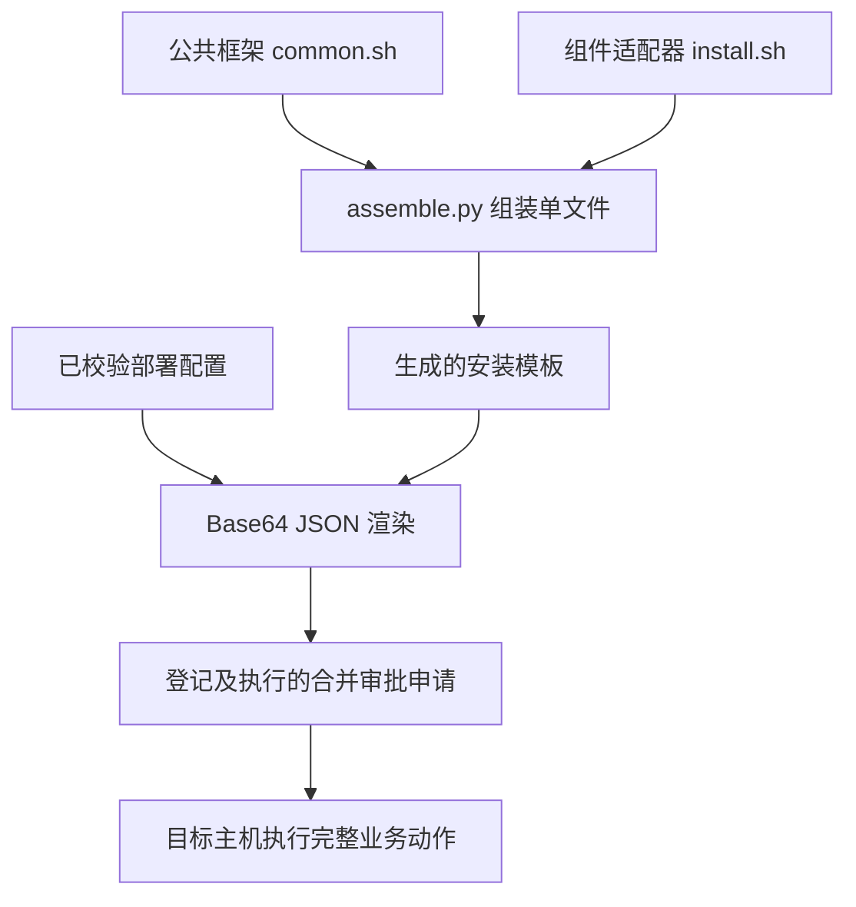

# YCYH 脚本编写架构与规范（v1.0）

适用范围：通过管控系统审批后，在Linux目标主机执行的组件部署脚本。本工程首先实现Elasticsearch新建集群，后续组件沿用同一框架。

## 一、设计原则

1. **一个完整业务动作，一份申请。** 一次部署覆盖检查、下载、安装、配置、启动、验证、结果回传。同一集群多主机纳入同一个DEPLOYMENT申请，不为每条命令、每个阶段单独调用管控接口。
2. **审批内容固定。** 公共框架和组件实现提前准备、评审、版本化；部署时只渲染已知配置并组装成单文件。审批人审核最终内容、SHA-256、主机和用户，批准后不修改、不远程下载其他执行脚本。
3. **主机自治。** 每台主机执行完整流程；oversight并行SSH到各目标，无需目标主机之间建立SSH信任。
4. **控制和信息回传分开。** 管控系统掌握执行；安装阶段、错误通过独立回传接口传递。回传接口不能启动脚本。
5. **验证后成功。** 启动命令返回不代表服务成功；必须完成服务/集群验证，之后回传SUCCEEDED并退出0。
6. **不盲目重试。** 已有目录拒绝覆盖，主机有互斥锁；远端执行状态不确定时保留证据并核查。当前是“重复执行阻断”，不宣称任意重入都可无损恢复。

## 二、源码分层

| 路径 | 职责 | 修改要求 |
|---|---|---|
| scripts/framework/common.sh | 配置载入、日志、回传、重试、错误捕获、清理、阶段编排 | 所有组件共用，变更需验证所有适配器 |
| scripts/components/elasticsearch/install.sh | ES前置检查、下载、安装配置、启动、组网验证 | 仅实现组件钩子，不复制公共回传代码 |
| scripts/assemble.py | 将框架和组件逻辑组装为一个脚本 | 生成后提交资源文件，CI用--check防止漂移 |
| clustermgr/.../ScriptRenderer.java | 将受控JSON转Base64并替换配置占位符 | 不直接拼接用户输入为Shell语句 |
| clustermgr/src/main/resources/scripts/install-es.sh | 待渲染的单文件安装模板 | 自动生成，禁止手工修改 |
| oversight/SshRunner.java | 对允许主机注入YCYH_TARGET_IP并执行脚本stdin | 不允许用户传入任意SSH选项 |



**归档下载的是软件安装包，不是运行时动态拉取的脚本代码。** 如需自定义安装钩子，应随最终脚本合并接受同一次审查。

## 三、公共执行约定

### 3.1 Shell基础

- `#!/usr/bin/env bash`，Linux/Bash，不使用 `/bin/sh` 的兼容性假设。
- `set -Eeuo pipefail`，`umask 077`，错误不应被静默忽略。
- 命名：公共变量大写；函数小写下划线；组件入口统一 `component_` 前缀。
- 所有路径和字符串变量双引号引用；路径型命令使用 `--` 终止选项，避免将文件名误识别为参数。
- 不在日志输出token、密码、私钥，不使用 `set -x`。
- 不修改HOME、PATH、系统时区或复用系统关键变量保存业务信息。
- 不执行未经校验的用户命令；本框架中唯一的eval用于读取受控Python `shlex.quote` 生成的变量赋值，禁止改为直接eval原始用户输入。
- 外部调用要设超时；预期可失败的探测放在if条件中，不用全局 `set +e` 掩盖安装错误。

### 3.2 配置载入

最终脚本内含一个Base64编码JSON配置，结构示例：

```json
{
  "nodes":[{
    "task_id":"任务UUID",
    "token":"仅本次回传的随机凭据",
    "callback_url":"http://管理服务:8080/api/callbacks/任务UUID",
    "package_url":"http://仓库:8082/elasticsearch-8.x-linux-x86_64.tar.gz",
    "sha256":"实际软件包的64位SHA256",
    "cluster_name":"es-demo",
    "node_name":"es-1",
    "host_ip":"192.168.10.11",
    "expected_nodes":2,
    "seed_hosts":["192.168.10.11","192.168.10.12"],
    "master_nodes":["es-1","es-2"]
  }]
}
```

Base64仅解决文本嵌入和转义，**不是加密**。任务配置必须通过审批与数据库权限保护。安装脚本只接收受控目标IP环境变量，不接收临时脚本参数，从而保持原单主机执行接口只有脚本UUID、主机IP、用户名三个参数。

配置生成前在管理端验证：集群名小写规范、主机来自配置白名单、包来自真实catalog、SHA格式正确、主机数≤8、无重复。管控端再次验证IP和用户。

### 3.3 生命周期

| 顺序 | 框架操作 | 组件钩子 | 允许的副作用/要求 |
|---:|---|---|---|
| 1 | 配置载入、注册trap、STARTED回传 | 无 | 配置不合法立即终止；先确认回传可用 |
| 2 | PREFLIGHT | component_preflight | 只检查前置条件、创建锁和任务日志，不修改既有安装 |
| 3 | DOWNLOAD | component_download | 私有暂存目录下载，设置超时、校验SHA和磁盘 |
| 4 | INSTALL | component_install | 安全解包，写本次组件配置，禁止覆盖既有目录 |
| 5 | INSTALLED回传 | 无 | 说明安装/配置已完成，但未确认服务可用 |
| 6 | START | component_start | 非交互启动，日志与PID明确，命令不能永久阻塞 |
| 7 | VERIFYING回传、VERIFY | component_verify | 带超时探测，验证实际业务条件 |
| 8 | SUCCEEDED回传、退出0 | 无 | 只有验证成功才能到达 |
| 异常 | ERR trap、FAILED回传、保留失败码 | 无 | 捕获阶段/行号/日志尾部，保留诊断数据 |
| 退出 | EXIT清理 | 无 | 只删本任务暂存目录和自己持有的锁 |

公共框架的 `run_stage` 负责阶段日志和PROGRESS回传。组件钩子返回非零即触发失败处理，不得自行伪造SUCCEEDED。当前实现失败时不自动停止已启动ES、不回滚目录；回滚必须另有可审核的动作脚本及审批。

## 四、新增组件的编码框架

新建 `scripts/components/<component>/install.sh`，实现以下五个钩子：

```bash
component_preflight() {
  # 验证用户、系统、依赖、端口、磁盘、目录、组件版本，取得互斥锁。
  # 失败打印可定位原因并 return 非零。
  :
}
component_download() {
  # 带超时下载固定包；必须核验审批配置中的SHA-256。
  :
}
component_install() {
  # 校验归档路径/链接，再安全解包；写入可审查配置，不覆盖既有安装。
  :
}
component_start() {
  # 用明确的用户、工作目录、日志与PID启动服务。
  :
}
component_verify() {
  # 检查真实服务状态和集群成员，失败返回非零；不得仅检查进程存在。
  :
}
```

上述是**结构示例，不是可执行安装实现**；占位 `:` 必须全部替换并通过验证后才准入。在组装工具增加组件选择，在管理系统增加对应软件/配置验证与入口，仍走合并申请。不能只新增一个空壳适配器就对外宣称支持某组件。

业务动作未来可拆为 `install`、`scale-out`、`scale-in`、`index-admin` 等组件适配器；每个动作按相同生命周期闭环实现，但仍以一次业务动作对应一份审批。缩容等破坏性动作必须在申请中明确数据迁移/安全退出前置条件，不复用当前新建安装模板代替。

## 五、日志与回传规范

- 本机任务日志记录UTC时间、阶段、目标路径、校验与验证结果；服务自身日志另存。前端按浏览器时区显示。
- 回传阶段固定 STARTED / PROGRESS / INSTALLED / VERIFYING / SUCCEEDED / FAILED，不增加未约定枚举值。
- 每个任务seq从1开始严格递增；一次事件重试不增加seq，接收端去重。
- 每个事件最多8000字符；公共框架截断到7000；失败仅附本机日志最后4500字节，不上传整份大日志。
- 回传使用 `Authorization: Bearer <任务token>`，token不放URL。重试最多3次，每次连接3秒、总8秒；失败不无限阻塞。
- 正常阶段回传失败会终止任务；错误处理中的回传尽最大努力，失败时仍保持原失败退出码。管理系统因此可能缺日志，须从目标主机获取。
- 不把HTTP200回传成功等同于部署成功：最终由管控退出结果和服务验证共同决定。

## 六、退出码规范

| 码 | 当前约定 | 管控对外结果 |
|---:|---|---:|
| 0 | 本机全部阶段及最终验证/回传成功 | 1 |
| 10 | 缺少基础配置/解释器等，可预检发现的错误 | 0 |
| 11 | 运行用户不符合要求（如root） | 0 |
| 12 | 系统参数/资源限制不符合要求 | 0 |
| 13 | 主机被其他安装任务占用 | 0 |
| 14 | 目标目录已有安装，拒绝覆盖 | 0 |
| 20 | 事件回传失败 | 0 |
| 30 | 服务/集群健康验证超时 | 0 |
| 其他非零 | curl、SHA、Python校验、JDK、启动命令等原始失败 | 0 |

部分命令的原始退出码保留，不保证所有错误都映射为固定自定义码。管控层只输出1/0，细节靠阶段、日志和内部执行记录定位。超时/SSH断连可能发生在副作用已经产生之后，不得据此自动重新安装。

## 七、ES适配器的具体规则

1. 仅全新部署，最多8台，每主机9200/9300一实例；全部节点均采用默认角色，512MiB堆仅用于PoC。
2. 执行用户必须非root；管理员预配系统参数，不在脚本里sudo。
3. 下载固定tar.gz并核验SHA；包解压前检查单一顶级目录、版本、绝对路径、上级目录穿越、危险文件类型、越界链接和链接下的子项；限制文件总数与声明解压大小。
4. 安装路径 `$HOME/ycyh-es/<cluster>/<node>`；主机级锁 `$HOME/ycyh-es/.deployment-lock`；暂存目录由 `mktemp` 创建，仅清理自身暂存。
5. 节点使用统一的discovery.seed_hosts和cluster.initial_master_nodes。不能将多主机安装错误配置成多个single-node集群。
6. 健康验证核对预期集群名、节点数、yellow/green和未超时；成功后删除首次引导配置。这里验证成员数，未逐项比对节点身份，正式模板可增加 `_nodes` 校验。
7. 显式关闭ES安全认证，管理端必须开启ALLOW_INSECURE_ES才能创建部署；正式环境需新增证书、密码和TLS实现，不能直接套用该PoC。
8. 软件包里的捆绑JDK与管理系统JDK11不同：ES按自身要求使用捆绑JDK，不能强制让ES运行在管理系统的JDK11上。

## 八、提交、审查与验证清单

| 类别 | 必须检查 |
|---|---|
| 源码 | 公共框架与组件适配器版本、变化原因、是否有未实现占位 |
| 参数 | 所有外部输入已校验；无命令拼接注入；token不泄露 |
| 制品 | 来源、版本、架构、操作系统要求、SHA与最终脚本一致 |
| 并发 | 主机锁、端口冲突、重复目录、不可确定结果处理 |
| 成功路径 | 全阶段执行、验证成功、最终回传、退出0 |
| 故障路径 | 包损坏、SSH失败、端口占用、无权限、资源不足、组网超时 |
| 审批 | 提交前不执行、驳回不执行、重复审批不重复执行 |
| 运行证据 | 脚本哈希、申请ID、UUID、主机、任务ID、回传和退出结果可关联 |
| 自动检查 | `bash -n`、`assemble.py --check`、项目测试、目标环境PoC |

```bash
# 修改框架/ES适配器后执行
python3 scripts/assemble.py
bash -n scripts/framework/common.sh
bash -n scripts/components/elasticsearch/install.sh
bash -n clustermgr/src/main/resources/scripts/install-es.sh
python3 scripts/assemble.py --check
mvn -B -ntp verify
```

规范中的扩展建议不代表已经实现自动回滚、断点续跑、动态角色规划、密钥托管或跨组件编排。新增能力必须有实际代码、接口与验证证据后才纳入功能清单。
